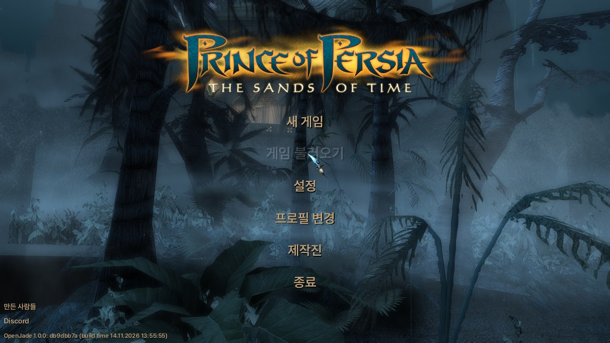
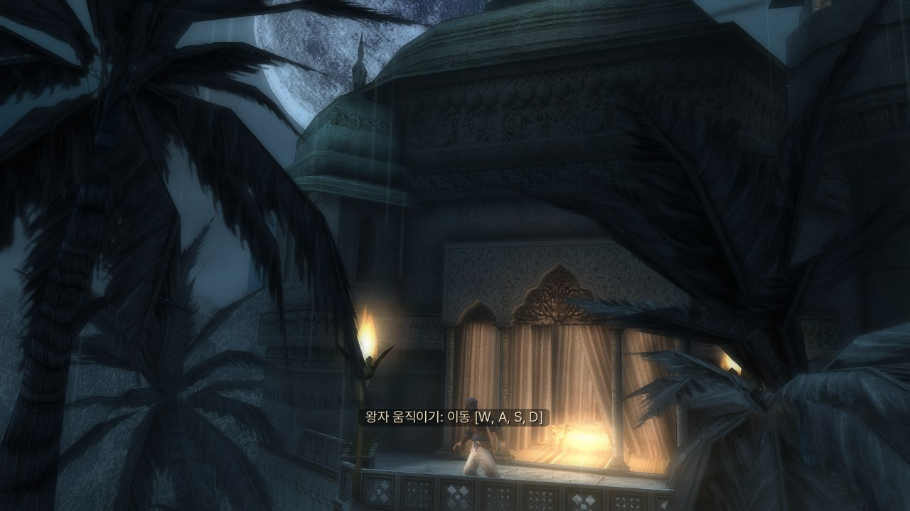
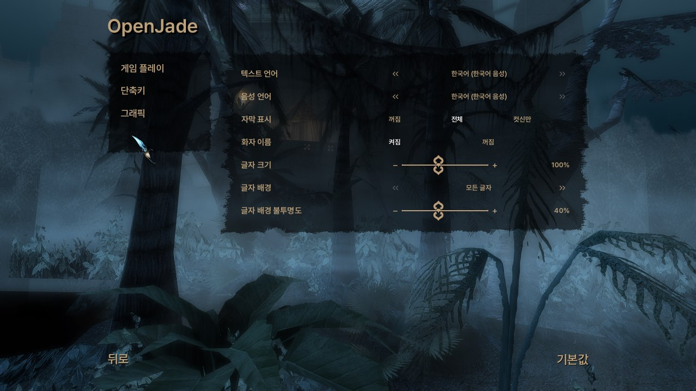
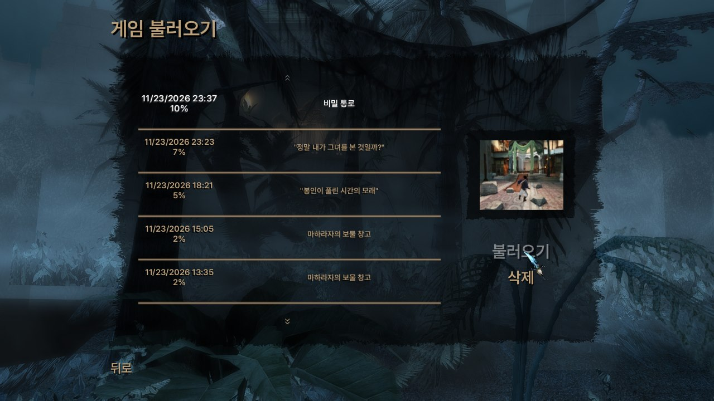

# 페르시아의 왕자: 시간의 모래 한글 패치 (OpenJade판)

**Prince of Persia: The Sands of Time — Korean language pack for OpenJade**

> **v0.9** · 한글화: **슬램백호**
> 어색한 번역, 오역, 자막 타이밍, 깨지는 글자를 발견하시면 [이슈](../../issues)로 알려 주세요.

<p align="center">
  
  
</p>

[OpenJade](https://github.com/dekamaru/openjade)는 원작 게임 파일을 그대로 읽어 실행하는 '페르시아의 왕자' 3부작 엔진 재구현입니다. 이 팩은 OpenJade에서 '시간의 모래'를 한국어로 즐길 수 있게 해 주는 **언어 팩**입니다. 게임 파일은 건드리지 않고, OpenJade의 `Languages` 폴더에 한국어를 추가합니다.

같은 방식의 한글 패치: [전사의 길](https://github.com/slam64/PoPWW-Korean-Patch) · [두 개의 왕좌](https://github.com/slam64/PoPT2T-Korean-Patch)

## 목차

- [다운로드](#다운로드)
- [이 패치의 특징](#이-패치의-특징)
- [두 가지 한국어, 무엇이 다른가요?](#두-가지-한국어-무엇이-다른가요)
- [준비물 (필수 / 선택)](#준비물)
- [호환되는 모드](#호환되는-모드)
- [처음 설치하는 분을 위한 가이드](#처음-설치하는-분을-위한-가이드)
- [게임을 더 편하게 즐기는 팁](#게임을-더-편하게-즐기는-팁)
- [문제 해결](#문제-해결)
- [업데이트와 제거](#업데이트와-제거)
- [설치 프로그램이 하는 일 / 직접 설치](#설치-프로그램이-하는-일)
- [알려진 한계](#알려진-한계)
- [바뀐 내용](#바뀐-내용) · [만든 사람과 고마운 분들](#만든-사람과-고마운-분들)

## 다운로드

[**Releases**](../../releases/latest)에서 `PoPSoT_Korean_OpenJade_v0.9.zip`을 받으세요.

> **추천은 '한국어 음성 + 한국어 자막'입니다.** 다만 한국어 음성(더빙) 파일은 저작권 때문에 이 팩에 들어 있지 않습니다. 국내 정식판의 음성 파일(정식판 설치 폴더, 또는 정식판에서 뽑은 `Sound`·`Video` 폴더)을 준비하면 설치 프로그램이 확인해서 넣어 줍니다. ([6단계](#6단계-한국어-음성-파일-준비-추천))

## 이 패치의 특징

- **한국어 두 가지를 게임 안에서 골라 쓰기** — **한국어 음성 + 한국어 자막**(국내 정식판 더빙)과 **영어 음성 + 한국어 자막**이 함께 들어 있습니다. 설정에서 텍스트 언어만 바꾸면 음성과 영상도 함께 바뀝니다.
- **완전 한글화** — 메뉴, 설정, 저장 지점 이름, 튜토리얼, 모든 대사와 영상 자막, OpenJade 전용 메뉴까지 한국어입니다.
- **원작 PC판에 없던 자막** — 원작에는 자막이 없었지만, OpenJade가 붙이는 음성 자막(대사 797개 + 영상 6편)을 모두 한국어로 옮겼습니다.
  - 한국어 음성판: 국내 정식판의 **한국어 더빙을 그대로 받아 적은 자막**입니다(1,114줄). 음성 인식으로 초안을 만들고 귀로 확인했으며, 영상 6편은 더빙 음성에 맞춰 자막 타이밍을 다시 잡았습니다. 정식판에는 없던 '더빙 + 한글 자막'을 함께 즐길 수 있습니다.
  - 영어 음성판: 영어 원문에서 **새로 번역**했습니다(1,047줄). 인물마다 말투를 정하고(왕자·파라, 재상, 샤라만 왕, 술탄, 병사), 영어 음성을 직접 들으며 화자를 검수했습니다. 영어 자막에 빠져 있던 대사도 하나 더했습니다.
- **깔끔한 글꼴** — 한글은 [Pretendard](https://github.com/orioncactus/pretendard)(SIL OFL)로 표시합니다.
- **게임 파일을 건드리지 않음** — 그래서 PoP Mod Manager의 **Sands of Time Essential Fixes**, **4K 텍스처 팩**과 함께 쓸 수 있습니다(둘 다 함께 쓰는 것을 확인했습니다).
- **안전한 설치** — `INSTALL.bat` 한 번으로 설치하고, `UNINSTALL.bat`으로 설치 전 상태로 되돌립니다. 한국어 음성 파일은 SHA-256으로 확인한 뒤에만 넣고, `settings.ini`의 다른 설정은 건드리지 않습니다.

## 두 가지 한국어, 무엇이 다른가요?

| | 한국어 음성 + 한국어 자막 (추천) | 영어 음성 + 한국어 자막 |
|---|---|---|
| 게임 안 이름 | `한국어 (한국어 음성)` | `한국어 (영어 음성)` |
| 음성·영상 | 국내 정식판 한국어 더빙 (영상 6편 포함) | 원작 영어 음성 |
| 자막 | 더빙 대사를 그대로 받아 적음 | 영어 원문에서 새로 번역 |
| 용어 | 단도, 대왕, 황혼의 탑, 대신 (더빙 그대로) | 단검, 마하라자, 새벽의 탑, 재상 |
| 필요한 것 | 이 팩 + 국내 정식판의 음성 파일 | 이 팩만 |
| 이런 분께 | 그 시절 더빙으로 다시 즐기고 싶은 분 | 원작 영어 연기를 좋아하는 분, 정식판 파일이 없는 분 |

메뉴와 튜토리얼은 두 쪽이 같습니다. 저장 지점 이름 중 대사를 인용한 8개만 각자의 대사에 맞췄습니다(한국어 음성판은 정식판 문구 그대로).

<p align="center">
  
  
</p>

## 준비물

### 필수

| 준비물 | 설명 |
|---|---|
| **페르시아의 왕자: 시간의 모래** PC판 | Steam판(영어)으로 확인했습니다. |
| **PoP Mod Manager** (무료) | OpenJade 설치와 원작 버그 수정 모드를 한 번에 처리합니다. [GitHub](https://github.com/kaminoer/PoP-Mod-Manager/releases) |
| **OpenJade 1.0.0** | PoP Mod Manager가 받아서 설치해 줍니다. 직접 설치해도 됩니다. [GitHub](https://github.com/dekamaru/openjade) |
| **이 한국어 팩** | [Releases](../../releases/latest)의 zip |
| Windows 10/11 64비트 | |

### 선택

| 준비물 | 설명 |
|---|---|
| **국내 정식판의 한국어 음성 파일** (추천) | '한국어 음성 + 한국어 자막'을 쓰려면 필요합니다. 정식판 설치 폴더, 또는 정식판에서 뽑은 `Sound`·`Video` 폴더(풀어 둔 폴더나 zip)를 준비하세요. 그 안의 `Sound\soundlocal.big`·`.fat`과 `Video\cine_*.int` 6개를 씁니다. ([6단계](#6단계-한국어-음성-파일-준비-추천)) |
| **4K 텍스처 팩** (무료) | Nexus Mods 계정(무료)이 있어야 받을 수 있습니다. [Nexus Mods](https://www.nexusmods.com/princeofpersiathesandsoftime/mods/22) |

**디스크 공간:** 원래 게임 외에 OpenJade용 게임 사본 약 1.3GB + PoP Mod Manager의 원본 백업 약 0.8GB + (한국어 음성을 쓰면) 약 0.4GB + (4K 팩을 쓰면) 약 7.4GB가 더 필요합니다.

## 호환되는 모드

| 모드 | 구분 | 이 팩과 함께 | 설명 |
|---|---|---|---|
| **Sands of Time Essential Fixes** (PMM, Simulatte·dekamaru) | 권장 | ✅ 확인 | OpenJade용 원작 버그 수정(높은 프레임에서 기둥 타기 충돌). PMM으로 OpenJade를 설치할 때 함께 적용할 수 있습니다. |
| **4K Texture Pack AI-Enhanced** + 선택 파일 **Texture support in OpenJade** (Evgeshajk) | 선택 | ✅ 확인 | 게임 텍스처 대부분을 4K로 바꿉니다. 한국어 팩과 함께 실행해 텍스처 1,945장 등록·교체를 확인했습니다. |
| HD Texture Pack (같은 Nexus 페이지의 가벼운 판, 1.2GB) | 선택 | ➖ 미확인 | 4K 팩보다 가벼운 판입니다. 같은 OpenJade 어댑터를 씁니다. |
| Unlock Prince Of Persia 1 (PMM, dekamaru) | 선택 | ➖ 미확인 | 숨겨진 원작 1편을 엽니다. 게임 데이터 모드라 언어 팩과 겹치지 않지만 직접 확인하지는 않았습니다. |
| 원래 실행 파일용 모드 (Sands of Time Fix Compilation, 4K 팩의 `d3d9.dll`·Bloom off, PMM의 Code mods 등) | 필요 없음 | — | OpenJade는 원래 실행 파일(`POP.EXE`)과 `d3d9.dll`을 쓰지 않습니다. OpenJade 폴더에 넣지 마세요. |

## 처음 설치하는 분을 위한 가이드

전체 순서: **Steam 게임 설치 → PoP Mod Manager로 OpenJade 설치 → (선택) 4K 텍스처 → (추천) 한국어 음성 파일 준비 → 한국어 팩 → Steam 실행 설정 → 실행**

아래 예시는 Steam 라이브러리가 `D:\SteamLibrary`인 경우입니다. 본인 PC의 경로로 바꿔 읽어 주세요.

> 💡 [전사의 길](https://github.com/slam64/PoPWW-Korean-Patch)이나 [두 개의 왕좌](https://github.com/slam64/PoPT2T-Korean-Patch) 한글 패치를 설치하면서 PoP Mod Manager를 이미 쓰고 있다면 2·3단계의 처음 설정은 건너뛰고, 왼쪽 목록에서 **Sands of Time**만 연결하면 됩니다.

### 1단계. Steam에서 게임 설치

1. Steam에서 **Prince of Persia: The Sands of Time**을 설치합니다.
   - 예: `D:\SteamLibrary\steamapps\common\Prince of Persia The Sands of Time`
2. 원래 실행 파일용 모드(Fix Compilation 등)를 설치한 적이 있다면, 먼저 Steam에서 **게임 우클릭 → 속성 → 설치된 파일 → 게임 파일 무결성 확인**으로 원본 상태로 되돌려 두세요. OpenJade는 원본 게임 파일로 쓰는 것이 좋습니다.

> ⚠️ **Steam 게임 폴더에 한국어 음성(정식판의 `Sound`·`Video` 폴더)을 덮어씌워 둔 경우** — 무결성 확인을 하면 한국어 음성이 영어 원본으로 되돌아가 사라집니다. 그 전에 게임 폴더의 `Sound`, `Video` 두 폴더를 **다른 곳에 통째로 복사해 두세요**(예: `D:\SoT_한국어음성\Sound`, `D:\SoT_한국어음성\Video`). 6단계에서 이 폴더를 씁니다.
> 덮어씌운 채로 OpenJade를 설치하면 영어 음성판에서도 한국어 음성이 나오게 되므로, 원래 게임 폴더는 원본(영어)으로 되돌린 뒤 4단계를 진행하는 것을 권합니다.

> 💡 OpenJade는 이 폴더를 **복사해서** 따로 설치됩니다. 원래 게임 폴더는 그대로 남으므로, 원래 게임(클래식)도 계속 실행할 수 있습니다.

### 2단계. PoP Mod Manager(PMM) 받기

1. [PoP Mod Manager Releases](https://github.com/kaminoer/PoP-Mod-Manager/releases)에서 최신 zip(예: `PoP.Mod.Manager.v2.1.3.zip`)을 받습니다.
2. 원하는 곳에 압축을 풉니다. 예: `D:\Games\PoPModManager`
   - `C:\Program Files`처럼 쓰기 권한이 필요한 곳은 피하세요.
3. 압축을 푼 폴더 **바로 안의** `PoPModManager.exe`를 실행합니다.
   - `app` 폴더 안에도 같은 이름의 파일이 있지만, 바깥 것이 업데이트를 적용한 뒤 실행해 주는 실행기입니다. 바로 가기를 만든다면 바깥 것으로 만드세요.

### 3단계. PMM 처음 설정과 원래 게임 연결

1. 처음 실행하면 **Choose where to keep your data** 화면이 나옵니다. **비어 있는 새 폴더**를 고르세요(예: `D:\Games\PoPModManager\data`).
   - 원본 `prince.bf` 백업(원래 게임용과 OpenJade용 두 개, 합쳐서 약 0.8GB)과 모드 목록이 여기에 저장됩니다. 지우지 마세요.
2. `.jtmod` 파일 연결을 물으면 아무 쪽이나 골라도 됩니다.
3. 왼쪽 목록 위쪽의 **Sands of Time**(원래 게임)을 누르고, 게임 폴더에 Steam 게임 폴더를 지정한 뒤 **Back up & connect**를 누릅니다.
   - PMM이 원본 `prince.bf`를 백업하고 게임을 연결합니다. 원래 게임 파일은 바뀌지 않습니다.

### 4단계. OpenJade 설치 (원작 버그 수정 포함)

1. 왼쪽 목록 아래쪽 **OPENJADE** 항목의 **Sands of Time**을 누르면 **Set up OpenJade** 화면이 나옵니다. 목록이 길면 조금 내려야 보입니다.
2. **1 Where should the OpenJade copy go?** — OpenJade를 설치할 폴더입니다.
   - PMM이 제안하는 기본 경로를 그대로 쓰는 것을 추천합니다: `D:\SteamLibrary\steamapps\common\Prince of Persia The Sands of Time (OpenJade)`
   - ⚠️ **원래 게임 폴더 안쪽**(예: `...\Prince of Persia The Sands of Time\OpenJade`)은 고를 수 없습니다. 주황색 경고 *"Pick a folder outside the game's own installation"*이 뜨고 설치 버튼이 켜지지 않습니다.
3. **Sands of Time Essential Fixes**를 더하는 항목은 **켜 둔 채로** 둡니다. PMM 제작진이 만든 OpenJade용 원작 버그 수정입니다.
4. **Copy game & install OpenJade**를 누릅니다. 게임 데이터를 복사하고, GitHub에서 OpenJade 1.0.0을 받아 설치한 뒤 Essential Fixes까지 적용합니다(1~2분).
5. 위쪽에 **Mods applied**, **OpenJade 1.0.0**, 목록에 **Sands of Time Essential Fixes — Applied**가 보이면 성공입니다.

> 💡 OpenJade의 세이브는 OpenJade 폴더의 `Profiles`에 따로 저장됩니다. 원래 게임의 세이브와는 섞이지 않습니다.

### 5단계. (선택) 4K 텍스처 팩

1. [4K Texture Pack AI-Enhanced](https://www.nexusmods.com/princeofpersiathesandsoftime/mods/22) 페이지의 **Files** 탭에서 두 가지를 받습니다.
   - **메인 파일 "4K Texture Pack"**(약 4.5GB): 그 안의 `Evgesha.JK`(약 7.4GB)
   - **선택 파일 "Texture support in OpenJade"**: 그 안의 `iphlpapi.dll`
2. 두 파일을 OpenJade 폴더(`...\Prince of Persia The Sands of Time (OpenJade)`)에 넣습니다.
   - 메인 파일의 `d3d9.dll`과 "Bloom off"는 원래 게임용입니다. OpenJade에는 필요 없습니다.
3. 4K 팩은 재업로드가 금지되어 있으니 반드시 원 배포처에서 받아 주세요.

### 6단계. 한국어 음성 파일 준비 (추천)

'한국어 음성 + 한국어 자막'을 쓰려면 **국내 정식판(한국어 더빙)** 의 파일 8개가 필요합니다.

```
Sound\soundlocal.big   Sound\soundlocal.fat
Video\cine_010.int  cine_110.int  cine_730.int  cine_750.int  cine_820.int  cine_830.int
```

아래 셋 중 **하나**를 준비하세요. 설치 프로그램은 어느 것이든 받습니다.

| 가진 것 | 7단계에서 고를 파일 |
|---|---|
| 국내 정식판을 설치한 폴더 | 그 폴더의 `Sound\soundlocal.big` |
| 정식판에서 뽑은 `Sound`·`Video` 폴더 (압축을 풀어 둔 것, 1단계에서 복사해 둔 것) | 그 `Sound` 폴더 안의 `soundlocal.big` |
| `Sound`·`Video` 폴더가 든 **zip 파일** (압축을 풀 필요 없음) | 그 zip 파일 |

- `Sound`와 `Video`는 **같은 폴더 안에 나란히** 있어야 합니다(`…\Sound\soundlocal.big`과 `…\Video\cine_010.int`). 다른 파일(`sound.big`, `VIS_*.int` 등)이 함께 있어도 괜찮습니다. 필요한 8개만 가져갑니다.
- 설치 프로그램은 파일이 이 팩이 자막을 맞춘 국내 정식판과 **같은지 SHA-256으로 확인**한 뒤에만 복사합니다. 원래 파일은 바꾸지 않습니다.
- 준비한 것이 없다면 이 단계는 건너뛰세요. 영어 음성판만 설치되고, 나중에 `INSTALL.bat`을 다시 실행해 추가할 수 있습니다.

### 7단계. 한국어 팩 설치

1. [Releases](../../releases/latest)에서 받은 `PoPSoT_Korean_OpenJade_v0.9.zip`을 **아무 곳에나** 풉니다.
   - OpenJade 폴더 안에 풀어도 됩니다. 그러면 설치 프로그램이 그 폴더를 바로 씁니다.
2. 게임이 꺼진 상태에서 **`INSTALL.bat`**을 실행합니다.
   - OpenJade 폴더를 자동으로 찾습니다(Steam 라이브러리, PMM 설정). 여러 곳에서 찾으면 번호를 고르고, 못 찾으면 폴더를 고르는 창이 뜹니다.
   - "Windows의 PC 보호" 창이 뜨면 **추가 정보 → 실행**을 누르세요.
3. **"한국어 음성 파일을 고를까요?"** — 6단계에서 준비했다면 `y`를 누르고, 파일을 고르는 창에서 6단계 표의 파일(`soundlocal.big` 또는 zip)을 고릅니다. 없으면 `n`(그냥 엔터)을 누릅니다.
   - PMM에 연결된 원래 게임 폴더나 OpenJade 폴더에 이미 한국어 음성이 있으면 설치 프로그램이 먼저 찾아서 "이 파일로 설치할까요?"라고 묻습니다. 그때는 엔터만 누르면 됩니다.
   - 파일 확인과 복사(약 401MB)에 잠시 걸립니다. 맞지 않는 파일이면 이유를 알려 줍니다([문제 해결](#문제-해결) 참고).
4. 둘 다 설치했다면 **처음에 쓸 언어**를 고릅니다(`1` 한국어 음성, `2` 영어 음성). 게임 안에서 언제든 바꿀 수 있습니다.
5. 마지막에 나오는 **Steam 실행 옵션 줄**을 복사해 두세요. 8단계에서 씁니다.

```
"D:\SteamLibrary\steamapps\common\Prince of Persia The Sands of Time (OpenJade)\launch_openjade.bat" %command%
```

### 8단계. Steam에서 OpenJade로 실행하기

Steam의 **[플레이]** 버튼은 원래 게임을 실행합니다. Steam에서 OpenJade를 실행하려면:

1. Steam 라이브러리 → 게임 우클릭 → **속성** → **일반** → **실행 옵션**
2. 7단계에서 복사한 줄을 붙여 넣습니다.
3. 이제 **[플레이]**를 누르면 OpenJade가 실행됩니다.

- 실행 옵션을 비우면 다시 원래 게임이 실행됩니다.
- Steam에서 실행하면 검은 명령 창이 함께 뜰 수 있습니다. OpenJade를 실행해 주는 `launch_openjade.bat`의 창이며, 게임을 끝내면 함께 닫힙니다.
- Steam 말고도 **PMM의 Launch game** 버튼이나, OpenJade 폴더의 `launch_openjade.bat`을 더블클릭해서 실행할 수 있습니다.

### 9단계. 처음 실행하고 확인하기

1. 로고 영상 뒤 프로필을 고르거나 새로 만들면 메인 메뉴가 **한국어**로 나옵니다.
2. **설정 → 그래픽**에서 해상도와 전체 화면을 맞추세요. OpenJade 전용 그래픽 설정은 **설정 → OpenJade → 그래픽**에 있습니다.
3. **설정 → OpenJade → 언어**에서 확인합니다.
   - **텍스트 언어**: `한국어 (한국어 음성)` 또는 `한국어 (영어 음성)`
   - **음성 언어**: 따로 고르지 마세요. 고르지 않으면 텍스트 언어를 따라가서, 한국어 음성판이면 한국어 더빙, 영어 음성판이면 영어 음성이 나옵니다.

설치 끝! 즐거운 플레이 되세요.

## 게임을 더 편하게 즐기는 팁

- **두 한국어 오가기** — **메인 메뉴의 설정 → OpenJade → 언어 → 텍스트 언어**에서 `한국어 (영어 음성)` ↔ `한국어 (한국어 음성)`을 바꿉니다. 음성과 영상도 함께 바뀝니다. 텍스트 언어는 메인 메뉴의 설정에서만 바꿀 수 있습니다.
- **음성 언어를 직접 고르면** 그 음성으로 고정됩니다(텍스트 언어를 바꿔도 음성이 그대로). 다시 텍스트 언어를 따라가게 하려면 게임을 끈 상태에서 `INSTALL.bat`을 다시 실행하세요(`settings.ini`의 `[sound] voice_pack` 줄을 지워 줍니다). 일부러 섞어 쓰는 것도 됩니다(예: 영어 음성판 자막 + 한국어 더빙).
- **자막·글자 설정** — 같은 화면에서 자막 표시(꺼짐 / 전체 / 컷신만), 화자 이름(켜짐/꺼짐), 글자 크기(75~150%), 글자 배경과 배경 불투명도를 바꿀 수 있습니다.
- **게임패드** — **설정 → 조작**에서 버튼 아이콘, 진동, 게임패드 감도를 바꿀 수 있습니다.
- **영상 건너뛰기** — 영상 중에 화면에 나오는 버튼을 **길게** 누르면 건너뜁니다. 처음 보는 영상도 건너뛰고 싶다면 **설정 → OpenJade → 게임 플레이**에서 켜세요.
- **세이브 백업** — 세이브는 OpenJade 폴더의 `Profiles` 폴더에 있습니다. 이 폴더만 복사해 두면 됩니다.
- **settings.ini 편집** — PMM의 OpenJade 화면 **Settings** 탭에서 `settings.ini`를 고칠 수 있습니다. 저장할 때 이전 파일을 자동으로 백업합니다.
- **4K 텍스처가 적용됐는지 확인** — OpenJade 폴더의 `openjade-evgesha.log`에 `ready: 1945 textures`가 있고, 게임 중에 `replace` 줄이 늘어나면 적용된 것입니다.
- **원래 게임으로 돌아가기** — Steam 실행 옵션을 비우면 원래 게임이 실행됩니다. 원래 게임 폴더는 OpenJade 설치 때 바뀌지 않습니다.

## 문제 해결

<details>
<summary><b>텍스트 언어 목록에 "한국어 (한국어 음성)"이 없어요</b></summary>

한국어 음성 파일을 넣지 않고 설치한 경우입니다(영어 음성판만 설치됨). [6단계](#6단계-한국어-음성-파일-준비-추천)의 파일을 준비해 `INSTALL.bat`을 다시 실행하고, "한국어 음성 파일을 고를까요?"에서 `y`를 누르세요.
</details>

<details>
<summary><b>영어 음성판(한국어 (영어 음성))에서도 한국어 음성이 나와요</b></summary>

원래 게임 폴더에 한국어 음성을 덮어씌운 채로 OpenJade를 설치해서, OpenJade 폴더의 기본 음성까지 한국어가 된 경우입니다.

1. 먼저 `INSTALL.bat`을 실행해 그 한국어 음성으로 '한국어 (한국어 음성)'을 설치해 둡니다(설치 프로그램이 OpenJade 폴더의 한국어 음성을 찾아 물어봅니다).
2. Steam에서 원래 게임 폴더를 **게임 파일 무결성 확인**으로 원본(영어)으로 되돌립니다.
3. 원래 게임 폴더의 `Sound\soundlocal.big`, `Sound\soundlocal.fat`, `Video\cine_010·110·730·750·820·830.int`를 OpenJade 폴더의 같은 자리에 덮어씁니다.
</details>

<details>
<summary><b>"Steam(영어)판의 음성 파일입니다"라고 나와요</b></summary>

Steam 게임 폴더(또는 OpenJade 폴더)의 `soundlocal.big`을 고른 경우입니다. 그 파일은 영어 음성입니다. **국내 정식판을 설치한 폴더**의 파일을 골라 주세요.
</details>

<details>
<summary><b>"이 팩이 맞춘 국내 정식판 한국어 음성과 다른 파일입니다"라고 나와요</b></summary>

파일이 손상되었거나, 이 팩이 자막을 맞춘 정식판과 다른 판의 파일입니다. 자막 타이밍이 음성과 어긋나므로 설치하지 않습니다(영어 음성판은 그대로 설치됩니다). 다른 판을 가지고 계시다면 [이슈](../../issues)로 알려 주세요.
</details>

<details>
<summary><b>텍스트 언어를 바꿨는데 음성이 바뀌지 않아요</b></summary>

음성 언어를 직접 골라서 한 언어로 고정된 경우입니다. 게임을 끈 상태에서 `INSTALL.bat`을 다시 실행하세요(`settings.ini`의 `[sound] voice_pack` 줄을 지워 줍니다). 또는 **설정 → OpenJade → 언어 → 음성 언어**에서 원하는 음성을 직접 고르세요.
</details>

<details>
<summary><b>PMM의 "Copy game & install OpenJade" 버튼이 켜지지 않아요</b></summary>

원래 게임 폴더 **안쪽**을 설치 폴더로 고른 경우입니다(경고: *Pick a folder outside the game's own installation*). PMM이 제안하는 기본 경로(`...\Prince of Persia The Sands of Time (OpenJade)`)처럼 게임 폴더 **바깥**을 고르세요.
</details>

<details>
<summary><b>PMM 처음 화면에서 데이터 폴더를 받아 주지 않아요</b></summary>

**비어 있는 새 폴더**만 고를 수 있습니다. 새 폴더를 만들어 고르세요.
</details>

<details>
<summary><b>INSTALL.bat이 OpenJade 폴더를 찾지 못해요</b></summary>

- 폴더를 고르는 창에서 `openjade.exe`가 있는 폴더를 직접 고르세요.
- 또는 한국어 팩 zip을 OpenJade 폴더 안에 풀고 거기서 `INSTALL.bat`을 실행하세요.
</details>

<details>
<summary><b>한국어가 아니라 영어로 나와요 / 글꼴이 섞여 보여요</b></summary>

- 메인 메뉴의 **설정 → OpenJade → 언어 → 텍스트 언어**를 한국어로 바꾸세요.
- 목록에 한국어가 없거나 영문과 한글 글꼴이 섞여 보인다면 `INSTALL.bat`을 다시 실행하세요(OpenJade 업데이트 뒤 등). 언어 팩과 `settings.ini`의 `[fonts.…]` 절을 다시 넣어 줍니다.
</details>

<details>
<summary><b>저장할 때 확인 창이 영어로 나와요</b></summary>

"Do you want to save the game? / Yes / No / Repeat vision" 창은 게임 데이터 안의 문구라 언어 팩으로는 바꿀 수 없습니다. [알려진 한계](#알려진-한계)를 보세요.
</details>

<details>
<summary><b>Steam [플레이]를 누르면 원래 게임이 실행돼요 / 아무것도 안 떠요</b></summary>

- 원래 게임이 실행된다면 실행 옵션이 비어 있는 것입니다. [8단계](#8단계-steam에서-openjade로-실행하기)를 확인하세요.
- 아무것도 안 뜬다면 실행 옵션의 경로가 실제 OpenJade 폴더와 다른 것입니다(폴더를 옮기거나 다시 설치한 경우). `INSTALL.bat`을 다시 실행하면 맞는 줄을 다시 보여 줍니다.
</details>

<details>
<summary><b>4K 텍스처가 적용되지 않아요</b></summary>

- `Evgesha.JK`와 `iphlpapi.dll`이 둘 다 OpenJade 폴더(`openjade.exe`가 있는 곳)에 있는지 확인하세요.
- `iphlpapi.dll`은 시간의 모래 페이지의 "Texture support in OpenJade" 파일이어야 합니다(전사의 길 것과 다릅니다).
- `openjade-evgesha.log`에 오류가 없는지 확인하세요.
</details>

## 업데이트와 제거

- **한국어 팩 새 버전** — 새 zip을 받아 새 `INSTALL.bat`만 실행하면 됩니다. 이전 버전 위에 그대로 설치되고, 이미 넣은 한국어 음성은 다시 고르지 않아도 그대로 씁니다.
- **OpenJade 새 버전** — PMM의 OpenJade 화면에서 업데이트할 수 있습니다. 업데이트 뒤 한국어가 안 나오면 `INSTALL.bat`을 다시 실행하세요. 이 팩은 OpenJade 1.0.0에 맞춰 만들었습니다. 새 버전에서 새로 생긴 문장은 영어로 나오거나 자막이 나오지 않을 수 있습니다.
- **제거** — `UNINSTALL.bat`을 실행하면 한국어 팩(복사해 넣은 한국어 음성 포함)을 지우고 `settings.ini`를 설치 전 언어로 되돌립니다. OpenJade 자체를 지우려면 PMM에서 연결을 끊은 뒤 OpenJade 폴더를 지우면 됩니다(세이브 백업 잊지 마세요).

## 설치 프로그램이 하는 일

설치 프로그램은 Windows 기본 PowerShell 스크립트(`patcher\OjKoPatch.ps1`)라 메모장으로 열어 볼 수 있습니다.

- OpenJade 폴더의 `Languages\한국어 (영어 음성)`에 영어 음성판(글자·자막 파일과 Pretendard 글꼴)을 복사합니다.
- 한국어 음성 파일을 고르면, 그 파일이 맞는지 SHA-256으로 확인하고 `Languages\한국어 (한국어 음성)`에 한국어 음성판과 함께 복사합니다. 고르지 않으면 이 폴더는 만들지 않습니다.
- `settings.ini`의 `[game] text_language`를 고른 한국어로 바꾸고, 한글 글꼴을 쓰는 `[fonts.한국어 (영어 음성)]`·`[fonts.한국어 (한국어 음성)]` 절을 넣습니다.
- `[sound] voice_pack` 줄이 있으면 지웁니다(음성이 텍스트 언어를 따라가게). 다른 설정은 바꾸지 않습니다.
- Steam 실행용 `launch_openjade.bat`을 OpenJade 폴더에 넣습니다(같은 이름의 다른 파일이 있으면 그대로 둡니다).
- 게임 파일(`prince.bf` 등)은 건드리지 않습니다.
- 바꾼 내용은 `KoPack_state.json`에, 진행 기록은 `KoPack_log.txt`에 남기고, `UNINSTALL.bat`이 이것으로 되돌립니다.

<details>
<summary><b>직접 설치하려면 (설치 프로그램 없이)</b></summary>

1. OpenJade를 한 번 실행했다가 끕니다(`settings.ini`가 생깁니다).
2. OpenJade 폴더에 `Languages\한국어 (영어 음성)` 폴더를 만들고, zip의 `patcher\pack\common`과 `patcher\pack\en_voice` 안의 내용을 모두 복사합니다.
3. (한국어 음성판) `Languages\한국어 (한국어 음성)` 폴더를 만들고 `patcher\pack\common`과 `patcher\pack\ko_voice`의 내용을 복사한 뒤, 정식판의 `Sound\soundlocal.big`·`soundlocal.fat`을 그 안의 `Sound` 폴더에, `Video\cine_010·110·730·750·820·830.int`를 `Video` 폴더에 복사합니다.
4. `settings.ini`를 메모장으로 열어 `[game]` 절의 `text_language`를 이렇게 바꿉니다(한국어 음성판은 `Languages/한국어 (한국어 음성)`).
   ```ini
   text_language = Languages/한국어 (영어 음성)
   ```
5. `[sound]` 절에 `voice_pack = …` 줄이 있으면 지웁니다.
6. 파일 끝에 아래 내용을 붙여 넣고 **UTF-8**로 저장합니다. 한국어 음성판도 넣었다면 같은 내용을 `[fonts.한국어 (한국어 음성)]`으로 한 번 더 넣습니다.
   ```ini
   [fonts.한국어 (영어 음성)]
   menu = Pretendard-SemiBold.otf
   menu_size = 1.0
   tutorial = Pretendard-Regular.otf
   tutorial_size = 1.0
   subtitles = Pretendard-Regular.otf
   subtitles_size = 1.0
   ```
</details>

## 알려진 한계

- **저장 확인 창은 영어** — 샘에서 저장할 때 나오는 "Do you want to save the game? / Yes / No / Repeat vision"은 게임 데이터(`prince.bf`) 안의 문구입니다. OpenJade는 시간의 모래의 이 문구를 8비트 코드 페이지로 읽어 한글을 표시할 수 없어서, 언어 팩으로는 바꿀 수 없습니다.
- **한국어 음성은 들어 있지 않음** — 국내 정식판의 음성 파일(설치 폴더, 또는 뽑아 둔 `Sound`·`Video` 폴더나 zip)이 있어야 '한국어 음성 + 한국어 자막'을 쓸 수 있습니다. 자막은 국내 정식판 더빙에 맞췄습니다.
- **OpenJade 1.0.0 기준** — OpenJade가 업데이트되어 새 문장이 생기면 그 줄은 영어로 나오거나 자막이 나오지 않을 수 있습니다.
- **v0.9는 첫 공개판** — 번역 검수를 계속하고 있습니다. 화면을 보며 확인할 화자 몇 줄과 영상 자막 타이밍은 플레이하며 다듬을 예정입니다.

## 바뀐 내용

**v0.9 — 첫 공개**
- 한국어 두 가지(`한국어 (영어 음성)`, `한국어 (한국어 음성)`)를 담은 OpenJade 언어 팩
- 영어 음성판: 영어 원문에서 새로 번역(대사·영상 자막 1,047줄, 메뉴·저장 지점, 튜토리얼 94개), 영어 음성을 들으며 화자 검수
- 한국어 음성판: 국내 정식판 더빙을 받아 적은 자막(1,114줄), 전체 검수 2회, 영상 6편 자막 타이밍을 더빙에 맞춤
- 설치·제거 프로그램: 사용자의 정식판 파일에서 한국어 음성을 SHA-256으로 확인해 복사, 음성이 텍스트 언어를 따라가도록 `voice_pack` 정리, Steam 실행용 `launch_openjade.bat`

## 만든 사람과 고마운 분들

- 한글화: **슬램백호**
- 원작: Ubisoft Montreal · 한국어 더빙: 국내 정식판
- [OpenJade](https://github.com/dekamaru/openjade): dekamaru
- [PoP Mod Manager](https://github.com/kaminoer/PoP-Mod-Manager): Simulatte (kaminoer) · Sands of Time Essential Fixes: Simulatte, dekamaru
- [4K Texture Pack AI-Enhanced](https://www.nexusmods.com/princeofpersiathesandsoftime/mods/22): Evgeshajk
- 글꼴: [Pretendard](https://github.com/orioncactus/pretendard) © Kil Hyung-jin, SIL Open Font License 1.1 (zip의 `patcher\pack\common\Pretendard-OFL.txt`)

이 팩은 비공식 팬 번역이며 Ubisoft, OpenJade, PoP Mod Manager와 관계가 없습니다. 게임 파일과 한국어 음성은 들어 있지 않습니다.
